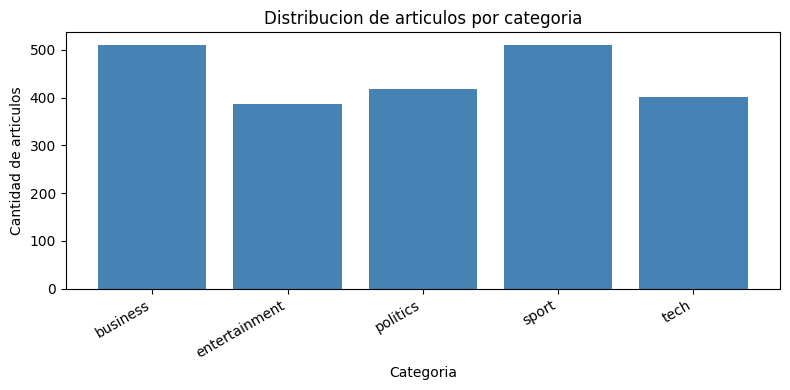

# BBC News Multi-Class Text Classification using BERT Transformers

This repository provides an end-to-end Deep Learning pipeline for multi-class news article classification using transfer learning and fine-tuning with pretrained BERT (`bert-base-uncased`) in PyTorch. The project investigates text representation learning, dataset balance, tokenization constraints, fine-tuning dynamics, and semantic boundary overlaps across five BBC news categories.

**Authors:** Sergio Pardo, Jefferson Moreno, John Pino  
**Program:** Master's in Artificial Intelligence — Deep Learning Techniques  
**Academic Term:** May 2026  

---

## Table of Contents

1. [Project Overview and Objectives](#project-overview-and-objectives)
2. [Dataset Description and Preprocessing](#dataset-description-and-preprocessing)
3. [Model Architecture and Tokenization](#model-architecture-and-tokenization)
4. [Training Protocol and Hyperparameters](#training-protocol-and-hyperparameters)
5. [Quantitative Results](#quantitative-results)
6. [Learning Dynamics and Overfitting Analysis](#learning-dynamics-and-overfitting-analysis)
7. [Error Analysis and Confusion Matrix](#error-analysis-and-confusion-matrix)
8. [Qualitative Inference and Stress Testing](#qualitative-inference-and-stress-testing)
9. [Repository Structure](#repository-structure)
10. [Installation and Usage Guide](#installation-and-usage-guide)
11. [References](#references)

---

## Project Overview and Objectives

Automated document categorization is an essential capability in modern Natural Language Processing (NLP). Digital news platforms publish thousands of articles daily; accurately sorting content into thematic sections is vital for recommendation engines, editorial workflows, content moderation, and search indexing.

Traditional text classification techniques relying on Bag-of-Words (BoW) or Term Frequency-Inverse Document Frequency (TF-IDF) capture n-gram statistics but discard syntactic ordering and deep contextual relationships. Recurrent Neural Networks (RNNs and LSTMs) process tokens sequentially, which hinders parallel training and causes gradient attenuation over lengthy documents.

The Transformer architecture overcomes these bottlenecks via multi-head self-attention, processing all tokens concurrently and deriving bidirectional contextual representations. This repository fine-tunes BERT (Bidirectional Encoder Representations from Transformers) on the BBC Articles Dataset, addressing:
- Exploitation of pretrained language representations with modest downstream training data (~1,700 samples).
- Systematic handling of document length variability and token truncation trade-offs.
- Empirical tracking of training dynamics, identifying the emergence of overfitting in high-capacity models (110M parameters).
- In-depth qualitative error analysis on articles exhibiting lexical and thematic overlap (notably between Technology and Business).

---

## Dataset Description and Preprocessing

The experiments utilize the **BBC Articles Dataset** (Jacopo Ferretti, Kaggle), consisting of 2,225 news articles published between 2004 and 2005. Each document is labeled with one of five editorial categories: `business`, `entertainment`, `politics`, `sport`, or `tech`.

### Data Cleaning and Deduplication

1. **Whitespace Normalization:** Redundant tabs, carriage returns, and multi-space sequences were collapsed into single space delimiters.
2. **Deduplication:** Following normalization, 100 identical duplicate articles (4.5% of the raw corpus) were detected and removed, resulting in **2,125 unique articles**. Removing duplicates before splitting prevents data leakage across partitions.
3. **Missing Value Verification:** The dataset contains zero null or missing entries in both article content and target labels.

### Class Distribution

The dataset displays a balanced category distribution without extreme class imbalance:

| Category | Raw Count | Cleaned Count | Percentage |
| :--- | :---: | :---: | :---: |
| Sport | 511 | 504 | 23.72% |
| Business | 510 | 503 | 23.67% |
| Politics | 417 | 403 | 18.96% |
| Tech | 401 | 346 | 16.28% |
| Entertainment | 386 | 369 | 17.37% |
| **Total** | **2,225** | **2,125** | **100.00%** |



### Article Length Analysis

Text length across news articles demonstrates wide dispersion:
- **Median length:** 332 words
- **Mean length:** 384.04 words
- **75th percentile:** 471 words
- **90th percentile:** 616 words
- **95th percentile:** 729 words
- **Maximum length:** 4,432 words


Because computational complexity in self-attention scales quadratically with sequence length ($O(N^2)$), setting a maximum token threshold is critical. `MAX_LENGTH = 256` was selected as an optimal operating point, capturing the core semantic message of the articles while maintaining computational tractability on standard hardware.

### Stratified Data Partitioning

To preserve identical category proportions across subsets, stratified splitting was performed with fixed random seed 42:
- **Training set:** 80% (1,700 samples)
- **Validation set:** 10% (212 samples)
- **Test set (hold-out):** 10% (213 samples)

---

## Model Architecture and Tokenization

### Tokenization

Text tokenization is handled by `AutoTokenizer.from_pretrained("bert-base-uncased")`, implementing the WordPiece algorithm with a 30,522 token vocabulary. WordPiece decomposes unknown or low-frequency words into sub-word tokens, effectively eliminating out-of-vocabulary (OOV) errors. Each sequence receives:
- Special delimiter tokens: `[CLS]` prepended at index 0 and `[SEP]` appended at sequence ends.
- `input_ids`: Integer token indices mapped to the BERT vocabulary.
- `attention_mask`: Binary vector assigning 1 to substantive text tokens and 0 to zero-padding tokens.

### Classification Architecture

Fine-tuning is conducted using `BertForSequenceClassification`:
- **Base Encoder:** BERT-base uncased (12 Transformer encoder layers, 768 hidden units per token, 12 attention heads, 110 million total parameters).
- **Classification Head:** Linear layer projecting the 768-dimensional `[CLS]` pooled representation to 5 class logits:

$$\mathbf{z} = \mathbf{W} \cdot \mathbf{h}_{\text{[CLS]}} + \mathbf{b}, \quad \mathbf{W} \in \mathbb{R}^{5 \times 768}, \quad \mathbf{b} \in \mathbb{R}^5$$

- **Regularization:** Dropout probability $p = 0.1$ applied to the pooled representation before linear projection.
- **Inference Probabilities:** Class probabilities derived via Softmax:

$$P(y = k \mid \mathbf{x}) = \frac{e^{z_k}}{\sum_{j=1}^{5} e^{z_j}}$$

---

## Training Protocol and Hyperparameters

Fine-tuning adapts both the encoder weights and the newly initialized classification head end-to-end:

| Hyperparameter | Configuration |
| :--- | :--- |
| Base Checkpoint | `bert-base-uncased` |
| Tokenizer | Hugging Face WordPiece (`bert-base-uncased`) |
| Sequence Max Length | 256 tokens |
| Batch Size | 16 |
| Optimizer | AdamW (Decoupled Weight Decay) |
| Learning Rate | 2e-5 |
| Betas | (0.9, 0.999) |
| Weight Decay | 0.01 |
| Loss Function | Categorical Cross-Entropy |
| Training Epochs | 5 |
| Checkpointing Strategy | Minimum Validation Loss (`val_loss`) |
| Random Seed | 42 |

---

## Quantitative Results

On the hold-out test set (213 articles never seen during training or validation), the fine-tuned model achieved an overall accuracy of **0.9624** (96.24%) and a macro F1-score of **0.9601**.

### Classification Report by Category

| Category | Precision | Recall | F1-Score | Support |
| :--- | :---: | :---: | :---: | :---: |
| **Business** | 0.9400 | 0.9400 | 0.9400 | 50 |
| **Entertainment** | 0.9487 | 1.0000 | 0.9737 | 37 |
| **Politics** | 0.9524 | 0.9756 | 0.9639 | 41 |
| **Sport** | 1.0000 | 1.0000 | 1.0000 | 51 |
| **Tech** | 0.9677 | 0.8824 | 0.9231 | 34 |
| **Accuracy** | — | — | **0.9624** | 213 |
| **Macro Average** | **0.9618** | **0.9596** | **0.9601** | 213 |
| **Weighted Average** | **0.9627** | **0.9624** | **0.9621** | 213 |

Key findings:
- **Sport:** Achieved perfect 1.0000 across precision, recall, and F1-score. Sports journalism utilizes unambiguous domain vocabulary (athlete names, match scores, tournaments) that is distinct from other sections.
- **Entertainment:** Achieved 1.0000 recall and 0.9737 F1-score, with zero false negatives.
- **Politics:** Reached 0.9756 recall and 0.9639 F1-score, misclassifying only one document.
- **Business:** Solid performance with balanced precision and recall at 0.9400.
- **Tech:** Lowest recall (0.8824) and F1-score (0.9231). While precision was high (0.9677), four technology articles were misclassified as business or entertainment due to topic intersection.

---

## Learning Dynamics and Overfitting Analysis

Tracking metrics across the 5 fine-tuning epochs reveals rapid optimization followed by the onset of overfitting:

| Epoch | Train Loss | Train Accuracy | Val Loss | Val Accuracy | Checkpoint Status |
| :---: | :---: | :---: | :---: | :---: | :---: |
| 1 | 0.5879 | 0.8735 | 0.1525 | 0.9717 | Saved (best val loss) |
| 2 | 0.0885 | 0.9835 | **0.0721** | **0.9764** | **Saved (optimal model)** |
| 3 | 0.0314 | 0.9953 | 0.0794 | 0.9811 | — |
| 4 | 0.0216 | 0.9971 | 0.1105 | 0.9764 | — |
| 5 | 0.0182 | 0.9959 | 0.2790 | 0.9434 | — |


### Discussion of Learning Curves

- **Rapid Convergence (Epochs 1–2):** Validation loss plummeted from 0.1525 to 0.0721, while validation accuracy reached 97.64%. Pretrained representations enable BERT to adapt quickly without extensive warmup on this dataset size.
- **Generalization Plateau (Epoch 3):** Validation accuracy peaked at 98.11%, but validation loss exhibited a slight upward tick (0.0794 vs 0.0721).
- **Overfitting Onset (Epochs 4–5):** Training loss dropped monotonically toward zero (0.0182) and training accuracy approached 99.7%. Meanwhile, validation loss rose sharply to 0.2790, and validation accuracy fell to 94.34%.
- **Validation-Loss Checkpointing:** Saving the model state dict from **Epoch 2** (minimum validation loss of 0.0721) protected the model against parameter degradation caused by late-epoch memorization.

---

## Error Analysis and Confusion Matrix

The confusion matrix highlights strong diagonal concentration, with only 8 total errors across the 213 test instances (3.76% error rate).


### Comprehensive Misclassification Audit

An examination of all 8 misclassified test articles reveals that errors stem primarily from semantic ambiguity and multi-thematic content rather than random misclassification:

| Article Headline / Snippet | True Label | Predicted Label | Confidence | Root Cause Analysis |
| :--- | :---: | :---: | :---: | :--- |
| *"Making your office work for you: Our mission to brighten up your working lives..."* | business | **tech** | 0.9482 | Discusses office ergonomics, software tools, and digital workflow enhancements. |
| *"Who do you think you are? The real danger is not what happens to your data as it crosses the net..."* | tech | **business** | 0.9276 | Analyzes corporate data privacy liabilities, identity theft costs, and risk management. |
| *"Web radio takes Spanish rap global: Spin the radio dial in the US and you are likely to find..."* | tech | **entertainment** | 0.8694 | Centers on hip-hop artists and digital streaming distribution channels. |
| *"Call to overhaul UK state pension: The UK pension system has been branded inadequate and too complex..."* | business | **politics** | 0.7979 | Covers government policy reforms, parliamentary debates, and fiscal pension legislation. |
| *"UK firms 'embracing e-commerce': UK firms are embracing internet trading opportunities as never before..."* | politics | **business** | 0.7001 | Comments by e-commerce ministers on market growth, corporate investment, and online retail. |
| *"EA to take on film and TV giants: Video game giant Electronic Arts says it wants to become..."* | tech | **business** | 0.6133 | Focuses on Electronic Arts' corporate expansion, studio mergers, and Hollywood competition. |
| *"Musicians 'upbeat' about the net: Musicians are embracing the internet as a way of reaching new fans..."* | tech | **entertainment** | 0.5872 | Discusses music distribution, digital downloads, and artists connecting with audiences. |
| *"US bank boss hails 'genius' Smith: US Federal Reserve chairman Alan Greenspan has given a speech..."* | business | **politics** | 0.5262 | Alan Greenspan's speech at a Scottish church referencing economic philosopher Adam Smith. |

These misclassifications highlight natural intersections between business strategy, technological platforms, regulatory politics, and entertainment media.

---

## Qualitative Inference and Stress Testing

To evaluate model behavior on unseen external text, several synthetic sentences were tested, including metaphorical language and sarcastic political commentary:

| Input Text | Predicted Label | Confidence | Linguistic / Semantic Context |
| :--- | :---: | :---: | :--- |
| *"The company reported higher quarterly profits after strong sales in international markets."* | **business** | 0.9661 | Standard financial press release phrasing. |
| *"The striker danced through the defense and turned the stadium into a roaring sea."* | **sport** | 0.9608 | Highly figurative language ("danced", "roaring sea"); correctly recognized via athletic terms ("striker", "defense", "stadium"). |
| *"What a surprise: politicians promised transparency again right before the election."* | **business** | 0.5032 | Sarcastic political phrasing. The model struggled with irony, assigning borderline confidence (0.5032 vs politics at 0.3541). |
| *"The new smartphone includes a faster processor and improved artificial intelligence features."* | **tech** | 0.9602 | Hardware and software consumer electronics terminology. |
| *"The film painted heartbreak in neon colors, and the audience left carrying the final scene like a song."* | **entertainment** | 0.9563 | Poetic arts review; correctly identified through entertainment anchors ("film", "audience", "final scene"). |

---

## Repository Structure

```
bbc-news-transformer-classifier/
├── .gitignore                      # Git exclusions for datasets, weights, virtual environments
├── LICENSE                         # MIT License
├── README.md                       # Comprehensive English documentation and experimental report
├── requirements.txt                # Production and development dependencies
├── environment.yml                 # Conda environment definition
├── main.py                         # Unified CLI entrypoint for training, evaluation, and inference
├── figures/                        # High-resolution experimental figures
│   ├── 01_dataset_distribution.png
│   ├── 02_text_length_distribution.png
│   ├── 03_training_validation_curves.png
│   └── 04_confusion_matrix.png
├── notebooks/                      # Exploratory and prototyping Jupyter notebooks
│   ├── bbc_news_classification.ipynb
│   └── microproyecto_03.ipynb
├── docs/                           # Original Spanish project report and conference paper draft
│   ├── microproyecto_03.md
│   └── articulo_bbc_v6.docx
└── src/                            # Modular PyTorch implementation
    ├── __init__.py
    ├── config.py                   # Centralized paths, model constants, and hyperparameters
    ├── data.py                     # Data ingestion, cleaning, tokenization, and PyTorch DataLoaders
    ├── model.py                    # Transformer instantiation and parameter inspection
    ├── train.py                    # Training engine with epoch loops and checkpoint tracking
    ├── evaluate.py                 # Evaluation metrics, confusion matrix, and single-sample inference
    └── utils.py                    # Seed configuration and visualization utilities
```

---

## Installation and Usage Guide

### 1. Clone the Repository

```bash
git clone https://github.com/JeffersonMoreno-137/bbc-news-transformer-classifier.git
cd bbc-news-transformer-classifier
```

### 2. Environment Setup

#### Option A: Using `venv` and `pip`

```bash
python3 -m venv .venv
source .venv/bin/activate
pip install --upgrade pip
pip install -r requirements.txt
```

#### Option B: Using `conda`

```bash
conda env create -f environment.yml
conda activate bbc-news-transformer
```

### 3. Dataset Download

The pipeline automatically downloads the BBC Articles dataset using `kagglehub` on its first run. Alternatively, download the dataset manually from [Kaggle](https://www.kaggle.com/datasets/jacopoferretti/bbc-articles-dataset) and place `bbc_text_cls.csv` in the `dataset/` directory:

```bash
mkdir -p dataset
# Place bbc_text_cls.csv into dataset/
```

### 4. Running the Pipeline via CLI

#### Training Mode (Full fine-tuning + evaluation)

```bash
python main.py --mode train --epochs 5 --batch-size 16 --lr 2e-5
```

#### Evaluation Mode (Evaluate saved checkpoint on test set)

```bash
python main.py --mode evaluate
```

#### Single Sentence Inference

```bash
python main.py --mode predict --text "The central bank decided to hold interest rates steady amid slowing inflation."
```

### 5. Running the Jupyter Notebook

To explore interactive execution, inspect intermediate tables, and reproduce plots:

```bash
jupyter notebook notebooks/bbc_news_classification.ipynb
```

---

## References

1. Kim, Y. (2014). *Convolutional Neural Networks for Sentence Classification*. Empirical Methods in Natural Language Processing (EMNLP), 1746–1751.
2. Vaswani, A., Shazeer, N., Parmar, N., Uszkoreit, J., Jones, L., Gomez, A. N., Kaiser, Ł., & Polosukhin, I. (2017). *Attention Is All You Need*. Advances in Neural Information Processing Systems (NeurIPS), 30, 5998–6008.
3. Devlin, J., Chang, M.-W., Lee, K., & Toutanova, K. (2019). *BERT: Pre-training of Deep Bidirectional Transformers for Language Understanding*. Proceedings of NAACL-HLT, 4171–4186.
4. Ferretti, J. (2023). *BBC Articles Dataset*. Kaggle. https://www.kaggle.com/datasets/jacopoferretti/bbc-articles-dataset
5. Ruder, S., Peters, M. E., Swayamdipta, S., & Wolf, T. (2019). *Transfer Learning in Natural Language Processing*. NAACL Tutorials.
6. Wolf, T., Debut, L., Sanh, V., Chaumond, J., Delangue, C., et al. (2020). *Transformers: State-of-the-Art Natural Language Processing*. EMNLP System Demonstrations, 38–45.
7. Loshchilov, I., & Hutter, F. (2019). *Decoupled Weight Decay Regularization*. International Conference on Learning Representations (ICLR).
8. Goodfellow, I., Bengio, Y., & Courville, A. (2016). *Deep Learning*. MIT Press.
